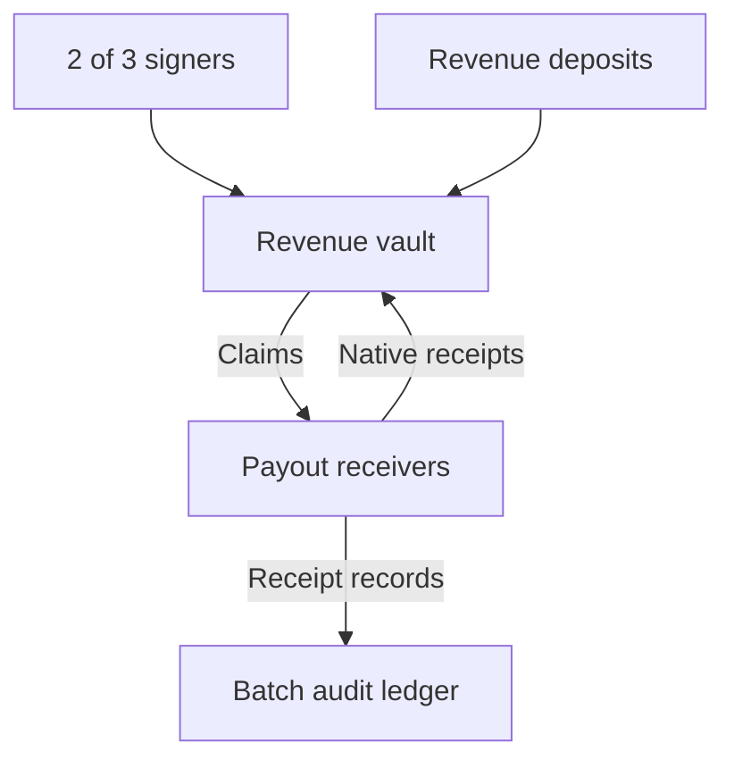

# AVM Revenue Hub

A Rust AVM reference application for sharing recurring revenue: a governed vault,
bound payout receivers, and an AccountBatch audit ledger. Built as a candidate
for the `gosh-sh/avm-sdk` example and regression suite. It is a local SDK project,
not an audited mainnet treasury or a mining/licence integration.

## What makes this useful

- **Fixed ownership:** up to 16 beneficiaries with distinct public keys,
  destinations, and positive weights totaling 10,000 basis points.
- **Recurring revenue:** any external signer can deposit principal. Each member's
  rights accrue from cumulative revenue; splitting a deposit into small payments
  cannot alter the resulting distribution.
- **Individual claims:** each beneficiary signs for their own claim, always to
  the fixed recipient. Different members can have transfers pending concurrently.
- **Async settlement:** successful receipts mark principal paid. A failure must
  return the exact principal before the beneficiary can retry.
- **Bounded state, continued retries:** no 64-attempt history limit. The vault
  keeps the latest native receipt hash and logical time for each member, checks
  the new attempt's causal time boundary, and relies on AVM-native queue replay
  protection and callback authenticity.
- **2-of-3 governance:** pause, resume, or change the operating SHELL reserve only
  after distinct votes on the exact proposal and expiration of a timelock.
  Managers cannot change ownership, redirect claims, or sweep principal.
- **Batch audit:** trusted receiver reports are authenticated by bound source and
  monotonically increasing nonce. Repeated semantic receipts do not double count.
  Updates patch only the affected 32-byte records in a 64 KiB retained payload.



## Verified local journey

The included actual AVM stand journey deposits 10,007 local main-value units with
50% / 30% / 20% ownership. This allocates 5,003 / 3,002 / 2,001 and carries one unit
of rounding dust. It then rejects a payout, returns principal, successfully
retries, checks quorum and timelock failures, pauses and resumes, and deposits
three more units. At total revenue 10,010, the final entitlements are:

| Member | Weight | Actual receiver total | Audit total |
| --- | --- | --- | --- |
| 0 | 50% | 5,005 | 5,005 |
| 1 | 30% | 3,003 | 3,003 |
| 2 | 20% | 2,002 | 2,002 |
| Total | 100% | 10,010 | 10,010 |

The test deliberately emits the second member's audit receipt twice as distinct
outbound intents. Its audit total and count remain 3,003 and one receipt.
Finally, the queue is empty and replay reproduces account root, registry root,
accepted-input count, and cumulative execution fees.

These are simulated main-value units. They are not a live NACKL balance. SHELL
for compute, rent, and delivery is separate from distributed principal.

## Validation

The deliverable contains actual outputs in [`evidence/`](evidence/):

- 74 project regression tests and 12 unmodified vendored SDK tests.
- 4,500 generated action steps, a 10,007-fragment deposit equivalence test,
  full-`u128` arithmetic cases, and 100 failed claims followed by a successful retry.
- Native and WASM Clippy with `-D warnings`.
- Reproducible official AVM builds, followed by two independent, byte-identical
  runs of a pinned Binaryen optimizer.
- Required guest exports and zero host imports; audit exports `process_batch`.
- Actual optimized-WASM execution in the pinned AVM local stand.
- Batch output measurements for 1, 8, 64, and 256 messages.

This is evidence for the tested paths and runtime combination. It is not a
formal proof or an independent security audit. The public GitHub workflow runs
these checks on pushes and pull requests. Its current result is available in
[GitHub Actions](https://github.com/h2so4nackl-code/avm-revenue-hub/actions).

## Batch size measurements

These are deterministic **native output-byte measurements**, not throughput or
FUEL benchmarks. Event/status bytes are included in canonical output columns.

| Messages | Patched records | Changed state bytes | Canonical patch output | Equivalent full-replace output |
| --- | --- | --- | --- | --- |
| 1 | 1 | 32 | 219 | 65,715 |
| 8 | 3 | 96 | 1,364 | 66,772 |
| 64 | 3 | 96 | 9,820 | 75,228 |
| 256 | 3 | 96 | 38,812 | 104,220 |

For one changed record, payload reduction is
`(1 - 32 / 65,540) × 100 = 99.951%`. That comparison concerns state-update payload,
not total execution cost. [`batch-probe.csv`](evidence/batch-probe.csv) retains
the actual measurements.

## Reproduce

Requirements: Linux x86-64 (Windows: WSL2), Rustup, Python 3, curl, tar, sha256sum.
The Rust workspace has no crates.io dependencies; the SDK is vendored unchanged.

```bash
rustup toolchain install 1.93.0 --profile minimal --component rustfmt --component clippy
rustup target add wasm32-unknown-unknown --toolchain 1.93.0
bash scripts/install_runtime.sh
bash scripts/install_binaryen.sh
bash scripts/check.sh
```

Binaryen's official archive is approximately 106 MiB compressed; installation
extracts only `wasm-opt`. Both installers verify pinned publisher SHA-256 values.

With existing verified tools:

```bash
bash scripts/check.sh /absolute/path/to/avm-sdk-linux-x86_64 /absolute/path/to/wasm-opt
```

For native tests only:

```bash
cargo test --workspace --offline
```

`build.sh` builds using explicit Cargo release-profile environment settings because
the published builder uses isolated manifests. `optimize.py` retains the original
`contract.compiler.wasm`, independently optimizes it twice, compares the results,
and writes the tested deployment artifact to `contract.wasm`. The optimization
is necessary to fit the pinned stand's canonical deployment-body size limit.
Always rebuild with `scripts/build.sh`, rather than only invoking Cargo.

## Components

| Path | Responsibility |
| --- | --- |
| `core/` | Checked entitlement math, configuration, state codecs, shared ABI IDs |
| `contracts/vault/` | Revenue, claims, native receipts, quorum, timelock |
| `contracts/receiver/` | Bound receipt endpoint and rejection/duplicate test controls |
| `contracts/audit/` | Authenticated per-member audit in isolated and batch execution |
| `tests/` | Actual contract entrypoint tests and batch probe |
| `scripts/` | Pinned setup, reproducible build, optimizer, E2E, artifact verification |
| `docs/` | Specification, comparison, and suggested SDK integration |

The ZIP includes built artifact quadruples (original compiler WASM, optimized
WASM, ABI, descriptor) under `contracts/*/target/avm`. These generated paths are
ignored by Git; source and build scripts reproduce them.

## Scope and limitations

- One fixed group per vault, 1 to 16 beneficiaries, and exactly three governance
  signers with a fixed threshold of two. Authorities cannot be rotated here.
- Components must be in the same DApp. The provided local stand validates that
  routing view; mainnet, partition splits, and cross-DApp execution are untested.
- A permanently missing native receipt leaves that member's claim pending.
  Other members can continue. There is no unsafe timeout reissue or admin sweep.
- At most `count - 1` units of rounding dust can remain until later revenue
  makes it distributable. There is no administrative dust withdrawal.
- Managers can pause new claims/deposits or change the operating reserve. That
  is an explicit availability power, even though they cannot redirect principal.
- The audit is an application receipt ledger, not a security audit. Audit delivery
  is asynchronous; a later audit failure can leave it behind an already paid
  claim. The demo asserts reconciliation for its tested journey, not universal
  delivery guarantees. There is no audit recovery service in this example.
- The receiver is a fixture that retains payout value and posts audit records;
  it has no wallet withdrawal or native NACKL asset adapter.
- Fee deposits and unused operating SHELL have no withdrawal entrypoint.
- Callback source, hash, and creation-LT checks supplement the runtime trust
  model. Arbitrary forged VM-owned callbacks are outside that model; the runtime
  must prevent their injection. No cross-runtime assurance is claimed.
- No real funds, licence, mining endpoint, mainnet deployment, reward decision,
  or third-party security audit is claimed. Local evidence and hosted CI results
  are separate records.

## Provenance and official references

- SDK source: [gosh-sh/avm-sdk at `72ee42dbf923f081bf29b4a1a1b6ea012b6af54f`](https://github.com/gosh-sh/avm-sdk/tree/72ee42dbf923f081bf29b4a1a1b6ea012b6af54f)
- Runtime: [avm-dev-335a0f09fdbc-sdk-0cbca40fad9a](https://github.com/gosh-sh/avm-sdk/releases/tag/avm-dev-335a0f09fdbc-sdk-0cbca40fad9a)
- Runtime source revision: `335a0f09fdbc98eb7a1056c0f6b84cd4f39d889e`.
- Optimizer: [WebAssembly/binaryen version_133](https://github.com/WebAssembly/binaryen/releases/tag/version_133).
- SDK source and runtime are different pinned revisions. Actual E2E evidence
  validates this combination, not an unpublished runtime.

See `PROVENANCE.json`, `evidence/runtime-build-manifest.json`, and `SHA256SUMS`.
MIT licensed, with the upstream SDK license retained.
